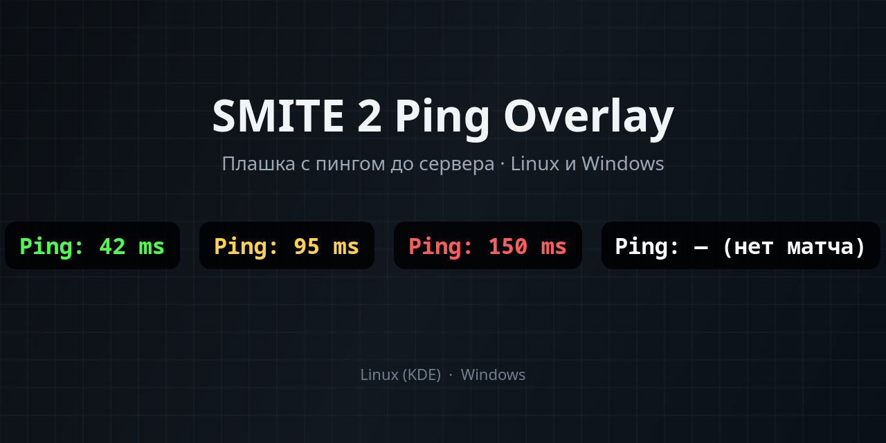

# SMITE 2 Ping Overlay

Маленькая отдельная плашка с пингом до сервера SMITE 2. В игру ничего не внедряется.

[](https://github.com/KartoShk4/smite2-ping-overlay/releases/latest)
[-brightgreen)](linux/)
[](windows/)

<p align="center">
  
</p>

<p align="center">
  
  &nbsp;
  
  &nbsp;
  
  &nbsp;
  
</p>

**[Скачать последнюю версию →](https://github.com/KartoShk4/smite2-ping-overlay/releases/latest)**

## Возможности

- Показать или скрыть плашку клавишей **F8**
- Чёрная полупрозрачная плашка со скруглёнными углами
- Можно перетащить мышкой — место запоминается
- Видна только когда окно игры активно; при сворачивании прячется
- Цвет зависит от пинга
- Портативно: без установщиков
- С версии **v1.1.0** бережно к ресурсам: сон без игры, пинг раз в 2 с, лог читается только при изменении

## Как работает

1. Читается лог игры (`LogNet: Browse`) — оттуда берётся IP сервера матча
2. Если сервер (часто Azure) не отвечает на ping, строится маршрут (traceroute) и выбираются последние отвечающие узлы
3. Пингуется ближайший отвечающий узел — это почти тот же пинг, что до сервера
4. На плашке показывается результат и цвет

В процесс игры ничего не внедряется: это отдельная программа поверх окна.

## Установка и запуск

### Windows (портативная)

1. Скачайте [`SMITE2-Ping-Windows.zip`](https://github.com/KartoShk4/smite2-ping-overlay/releases/latest) из [релизов](https://github.com/KartoShk4/smite2-ping-overlay/releases/latest)
2. Распакуйте папку целиком
3. Запустите `Запуск.bat`
4. В трее появится значок (чёрный кружок с зелёной точкой)

Нужен только встроенный PowerShell 5.1. Ничего устанавливать не нужно.

Игра должна быть в режиме **«Оконный без рамки»** (Borderless) — в полном экране плашка не будет видна поверх игры.

Подробнее: [`windows/README.txt`](windows/README.txt).

### Linux (KDE Plasma)

Нужны: Python 3, PyQt5, `traceroute`, `ping`.

1. Скачайте [`SMITE2-Ping-Linux.zip`](https://github.com/KartoShk4/smite2-ping-overlay/releases/latest) или возьмите файлы из [`linux/`](linux/)
2. Положите `smite2_ping.py` и `kwin_focus.js` в одну папку
3. В `smite2_ping.py` поправьте `GAME_LOG` под свою библиотеку Steam (`compatdata/2437170/...`)
4. В `smite2-ping.desktop` поправьте путь к скрипту, скопируйте файл в `~/.local/share/applications/`
5. В «Комбинации клавиш» KDE назначьте **F8** на это приложение

Повторный запуск закрывает плашку — так F8 работает как переключатель. Пока игра держит клавиатуру, глобальная F8 в KDE может не срабатывать: запускайте с рабочего стола, плашка сама появится поверх игры.

Опционально: `smite2-ping-move.desktop` шлёт сигнал и циклически двигает плашку по углам экрана.

## Управление

| Действие | Windows | Linux |
|---|---|---|
| Показать / скрыть | **F8** (или меню трея) | **F8** (через .desktop) |
| Перетащить | Мышью за плашку | Мышью за плашку |
| Выход | Трей → «Выход» | Повторный F8 / завершение процесса |
| Вернуть в угол | Трей → «Вернуть плашку в угол» | `smite2-ping-move.desktop` (по углам) |

## Цвета пинга

| Цвет | Пинг |
|---|---|
| Зелёный | &lt; 60 мс |
| Жёлтый | &lt; 120 мс |
| Красный | ≥ 120 мс |

## FAQ и устранение неполадок

**Плашка не видна поверх игры**  
Windows: поставьте в игре «Оконный без рамки». Linux: плашка показывается только когда окно SMITE 2 активно (через скрипт KWin).

**«нет матча» / «игра не запущена»**  
Нужен запущенный SMITE 2 и подключение к серверу. В меню/лобби адреса матча ещё нет.

**«нет лога игры»**  
Windows: проверьте `%LOCALAPPDATA%\SMITE2Alpha\Saved\Logs\Hemingway.log`.  
Linux: поправьте `GAME_LOG` в скрипте под путь Proton/`compatdata`.

**«ищу маршрут…»**  
Первые секунды после входа на новый сервер — идёт traceroute. Подождите.

**«нет ответа»**  
Узлы маршрута временно не отвечают. Плашка несколько раз держит прошлое значение, потом пишет ошибку.

**Windows ругается SmartScreen / антивирус**  
Скрипт открытый (PowerShell + C#). «Подробнее» → «Выполнить в любом случае». Ошибки пишутся в `%TEMP%\smite2_ping_error.log`.

**F8 не работает в Linux во время игры**  
Игра может перехватывать клавиатуру. Запускайте плашку до входа в матч или с рабочего стола.

## Релизы

Актуальная сборка: **[Latest release](https://github.com/KartoShk4/smite2-ping-overlay/releases/latest)**  
Файлы: `SMITE2-Ping-Windows.zip`, `SMITE2-Ping-Linux.zip`.

## Структура репозитория

```
linux/     — Python + PyQt5 + KWin focus
windows/   — портативный PowerShell (Запуск.bat)
assets/    — картинки для README
```
